<p align="center">
  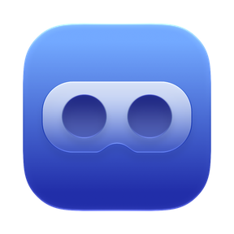
</p>

<h1 align="center">Halliday</h1>

<p align="center">
  <b>A free, open VR platform for the Mac.</b><br>
  The PlayStation VR2 on Apple Silicon: your Mac around you, the web in VR, and VR games.
</p>

<p align="center">
  
  
  
  
  
  <a href="https://github.com/sponsors/ThiagoTelho"></a>
</p>

<p align="center">
  <a href="#what-it-does">What it does</a> ·
  <a href="#status">Status</a> ·
  <a href="#how-it-works">How it works</a> ·
  <a href="#privacy">Privacy</a> ·
  <a href="#install">Install</a> ·
  <a href="#getting-started">Getting started</a> ·
  <a href="docs/extensions.md">Extensions</a> ·
  <a href="#support-halliday">Support</a>
</p>

<p align="center">
  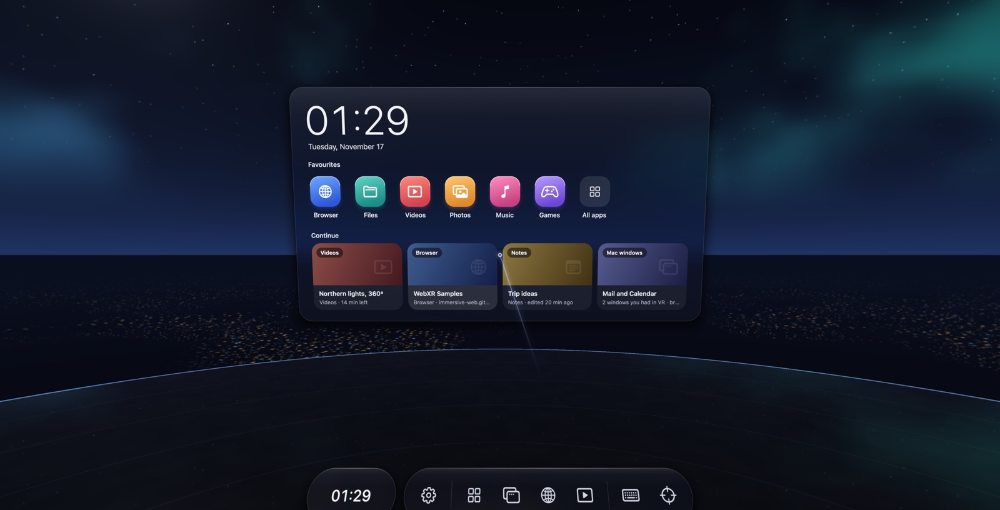
</p>

## Why

Halliday started with [GAV PSVR2 Player](https://github.com/GAVProject/gav-psvr2-player-mac), a
native macOS app that already plays VR video on the PlayStation VR2. I used it, and I wanted
more than a video player: my Mac's apps around me, the web in VR and games, in one place, the
way SteamVR gathers everything VR on Windows. I couldn't find that for the Mac, so I started
putting it together.

Halliday isn't built from scratch, and it isn't the first open VR software to reach the Mac.
It talks to the headset with knowledge from the open-source PS VR2 driver in
[Monado](https://gitlab.freedesktop.org/monado/monado), whose authors reverse-engineered Sony's
protocol. GAV PSVR2 Player showed how to drive the headset well on macOS, and
[PSVR2Toolkit](https://github.com/BnuuySolutions/PSVR2Toolkit) supplied the commands that turn
on its cameras. Halliday ports what it uses from these projects (see [Credits](#credits)) and
builds the rest on top:

- **Your Mac, around you.** Your apps as large floating windows, a browser made for VR, and a
  player for 360° and 3D video, in a calm place of your choosing.
- **The PS VR2 on macOS.** Sony supports the headset only on a PlayStation or a Windows PC. Like
  GAV PSVR2 Player, Halliday drives it from macOS through Sony's PC adapter, with no kernel
  extension and no root.
- **Yours, and only yours.** No account, no store, no tracking. See [Privacy](#privacy).
- **VR games on the Mac.** Windows VR games installed through GameHub run under Wine with
  Halliday as their VR runtime, in place of SteamVR. Quest apps you own run natively on Apple
  Silicon through [Klepton](https://github.com/shinyquagsire23/Klepton), with Halliday as their
  OpenXR runtime.

## What it does

### Mac windows in VR

Bring any app's windows into VR: up to eight, side by side in an arc or in layouts (Side by side,
Focus, Grid), each with its menus, pop-ups and dialogs. Move them with the bar under each window,
resize them from a corner, push them away or pull them closer. Click into one and the mouse and
keyboard go to it, or point at it with a Sense controller. Windows go back exactly where they
were when Halliday quits, even after a crash.

<p align="center">
  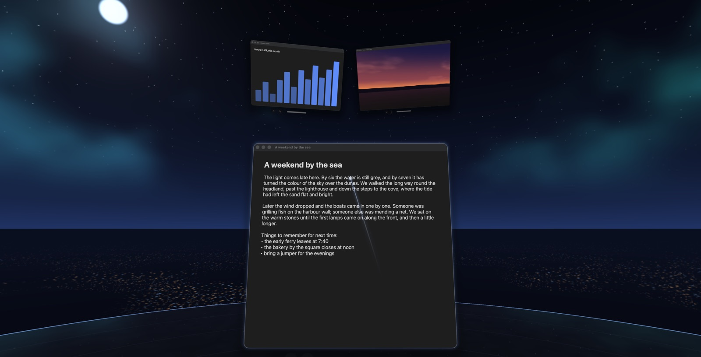
  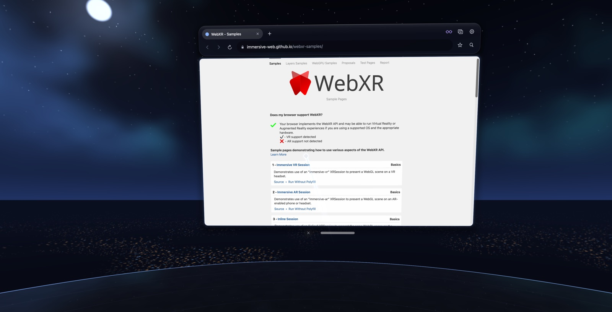
</p>

### A browser made for VR

Tabs, several windows, bookmarks, history, private tabs, find in page, zoom, and **its own
implementation of WebXR**, so VR websites run right inside it: 3D scenes, Gaussian splats,
360° video players, WebGPU pages and WebXR Layers. A video on any page moves to Halliday's own
player with **Watch in VR**.

### A video player for every kind of VR video

360°, 180°, fisheye and flat; 2D or 3D, side by side or top and bottom. Your videos are a wall of
large pictures that come alive under the pointer, with how far you watched and what is left.
Subtitles (from the file or an `.srt` beside it), audio tracks, HDR, MKV through ffmpeg, a seek
bar that previews the picture, a screen you can make larger or smaller and tilt, *Continue watching*, and the next video of the
folder at the end. Videos made for passthrough (a green, blue or black backdrop, or a mask in the
frame) can put the room behind the picture, with the backdrop found in the video by itself.

<p align="center">
  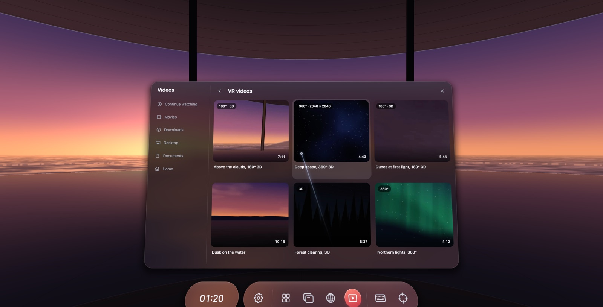
  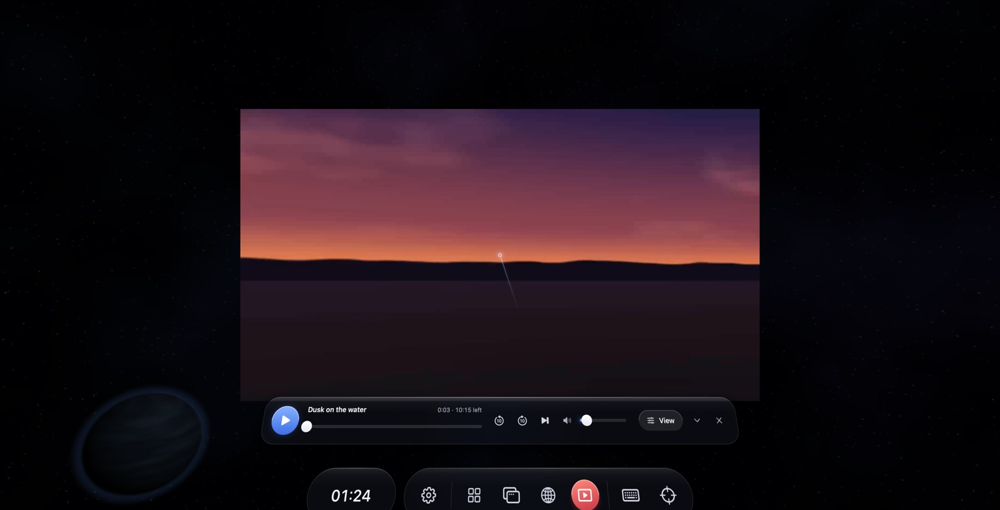
</p>

### Its own interface: Night Glass

A dock one glance down, a launcher for Halliday's apps and the Mac's, a home with your favourites
and what you were doing, quick settings, a virtual keyboard, notices and interface sounds. Panels
are real glass: they blur and shade the place behind them, glow at their edges, and move with
easing at three speeds. Every control has its hover, press and disabled states, and every panel
its loading, empty and error moments.

<p align="center">
  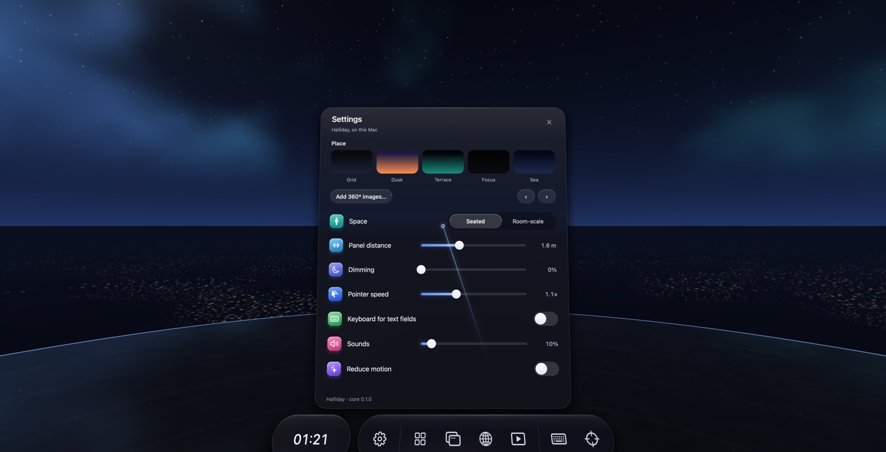
  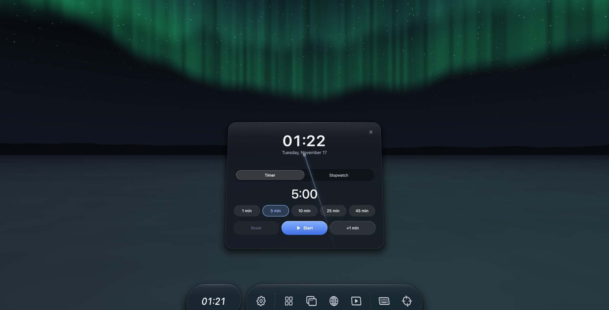
</p>

### Places to be in

Ten places, drawn on the GPU and baked once so they cost nothing at 120 Hz: a pavilion above a sea
of clouds, Dusk over still water, a terrace at night above a city of lights, a sea under the moon,
dunes at first light, a forest clearing with fireflies, a snowfield under an aurora, deep space,
a dark Focus room, and the classic grid. Or any 360° photo or 3D scene of your own. Press **T**,
or the button under the visor, to see your room through the headset's cameras instead.

<p align="center">
  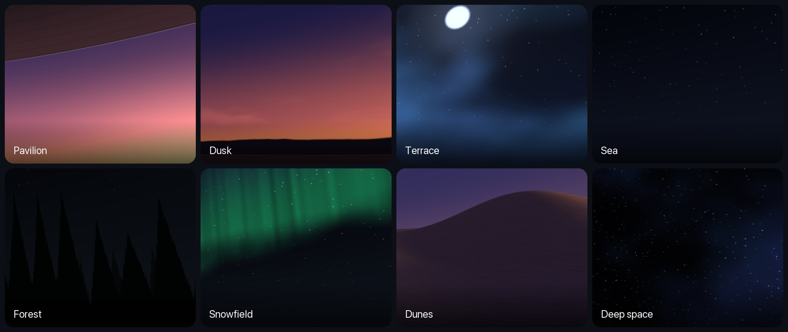
</p>

### VR games

Halliday ships its own **OpenVR runtime** for Windows games. A game started from GameHub loads it
instead of SteamVR's, believes it is on SteamVR with two Vive controllers, and sends its frames to
Halliday, which shows them in the headset with its own head tracking. It does the rest of a VR
compositor's job too: the game's floating menus and overlays (which take the pointer), its loading
sky, its fades, focus and quit. Frames reach Halliday through a window it captures, so a frame
costs the game well under a millisecond.

The **Games** app lists the VR games installed in GameHub, sets each one up for Halliday in one
step (and undoes it just as easily), and starts them. **Esc**, or the PS button, brings Halliday
up over a running game: the game pauses, its world stays around you dimmed and blurred, and a bar
offers Back, Recenter, Quit, the volume, the floor's height and the headset's brightness.

<p align="center">
  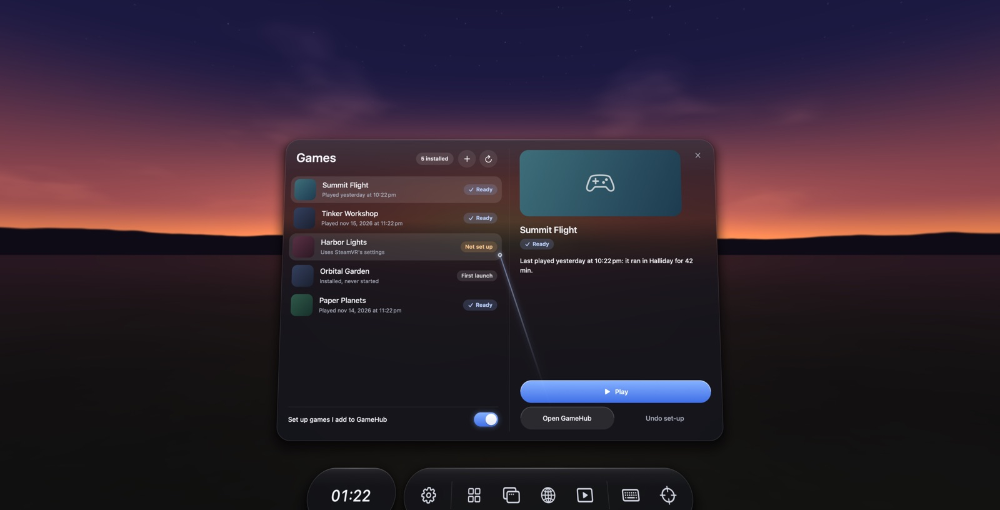
  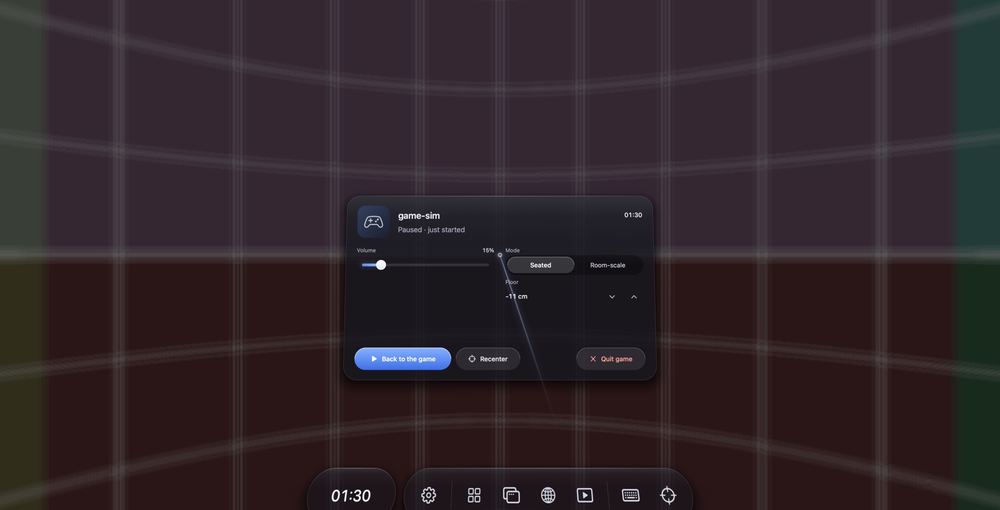
</p>

**Quest apps** install from an `.apk` file (open it in Files, or drop it on the companion window)
and appear in Games. They run through Klepton's runner on Halliday's own OpenXR runtime, with the
Sense controllers as their hands, passthrough behind their scene, and the panel's full
resolution. An app whose interface is a web page inside its package opens as that page in
Halliday's browser, and starts its VR part from there.

### Extensions

Halliday's own code stays general, so what one app needs comes from an **extension**: a small
folder of JSON and JavaScript, installed from the companion. An extension answers an app's own
calls from inside a sealed JavaScript context. It can't reach the rest of your Mac, and it can
only download from the hosts its manifest lists, which you see before installing it. The guide to
writing one is [docs/extensions.md](docs/extensions.md), also shown in the companion, with a
working example in [extensions/example](extensions/example). Extensions are shared as GitHub
repositories: paste one's link in the companion to install it.

<p align="center">
  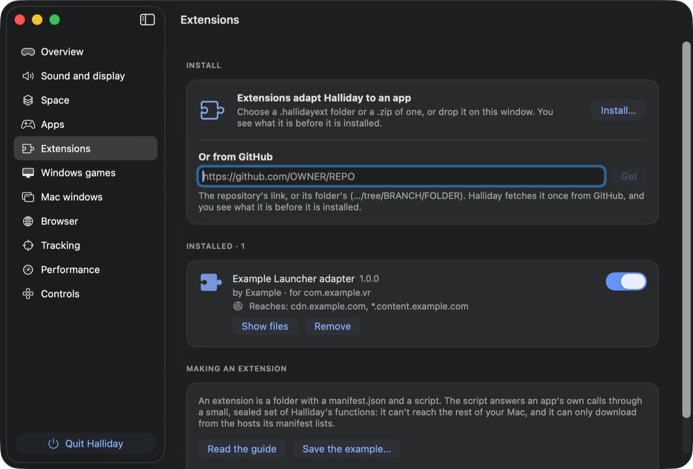
</p>

### Small apps of its own

Files, Photos (flat and 360° pictures), Notes, Clock (a timer and a stopwatch that keep running),
and Music, which shows and controls what Music or Spotify is playing. One volume for everything
Halliday plays, from quick settings, the video bar or the Mac's volume keys.

### The companion

A window on the Mac's own screen for what is easier with the headset off: the headset's and
controllers' state, every setting, the Quest apps and extensions you installed, the games' set-up, the Mac's
windows to bring in, a live performance chart against the display's budget, and the full list of
controls. From it Halliday moves between the headset and the Mac's screen without a restart.

The first time, it walks you through setting up: the headset, the two permissions and why each is
needed, seated or standing and the place to stand in, and the controls you'll use most.

<p align="center">
  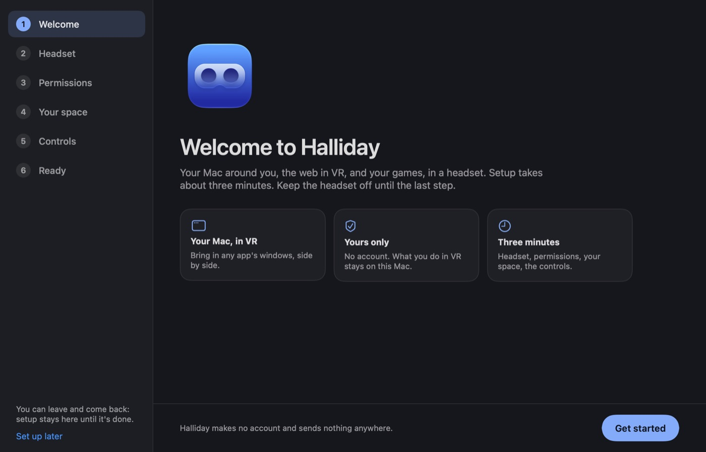
  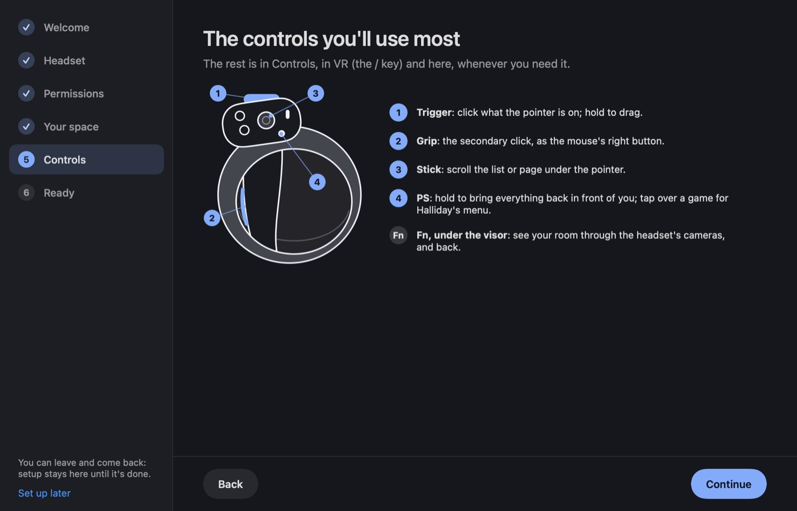
</p>

### The headset itself

Halliday talks to the PS VR2 over USB with the protocol from Monado's driver. It tracks the head
from the headset's own inside-out tracking and its 2000 Hz gyroscope, and predicts it to the
moment each row of the panel lights up, as GAV PSVR2 Player does. It corrects for the lenses'
distortion and colour fringes with Monado's formulas, and turns the picture once more for the
newest head pose just before it goes out (late latching). The Sense controllers connect over
Bluetooth. The headset's cameras see their LEDs, pulsed in step with each exposure, and Halliday
fuses what they see with each controller's accelerometer, so the hands keep their place between
camera frames.

This is what the headset's panel receives:

<p align="center">
  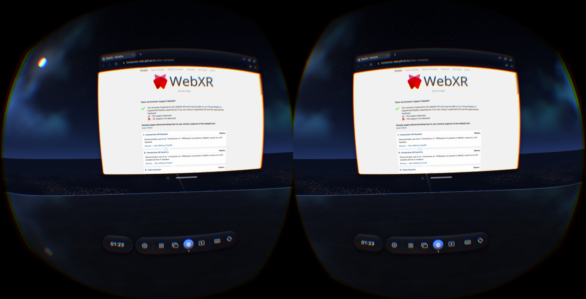
</p>

## Status

**Early development.** Halliday runs on a real PS VR2, tracked, at 120 Hz, with the lens
correction right. The Sense controllers point, click and are seen by the headset's cameras.
Mac windows, the browser and WebXR, the video player, the places, the built-in apps, Windows VR
games and Quest apps all work today. It is young: expect rough edges. A signed and notarized build is on the
[Releases](https://github.com/ThiagoTelho/halliday/releases) page, and it builds from source in
a few minutes.

Still open: controller tracking at the edges of the view and in fast movement, haptics, sound
through the headset, curved panels, and comfort tuning of sizes and distances.

| Area | State |
|---|---|
| Headset: display, head tracking, lens correction | ✅ on the headset |
| Sense controllers: buttons, pointing | ✅ on the headset |
| Sense controllers: position from the cameras | 🟡 live, being refined |
| Passthrough | ✅ the bottom cameras' wide fisheyes |
| Mac windows, browser, WebXR, video, built-in apps | ✅ |
| Windows VR games (OpenVR, under Wine through GameHub) | ✅ OpenGL and Direct3D 11 games |
| Quest apps (OpenXR, through Klepton) | 🟡 working, young |
| OpenXR for native Mac apps | 🟡 Metal sessions through the Khronos loader |

## How it works

```
 PS VR2 ──USB──► halliday-core (Rust): USB protocol, SLAM + IMU head tracking and prediction,
   │                                    lens correction, cameras, Sense controllers
   └◄─DisplayPort── Halliday.app (Swift, Metal): compositor, places, Night Glass interface
                         ├─ Mac windows: a virtual display + ScreenCaptureKit, input through an event tap
                         ├─ browser: WebKit with Halliday's own WebXR implementation
                         ├─ video player: AVFoundation → Metal, 360° / 180° / fisheye / flat, 2D or 3D
                         └─ apps and games: a shared-memory bridge
                              ├─◄─► vrclient_x64.dll (Rust, no_std): Windows games under Wine, in place of SteamVR
                              └─◄─► libhalliday_openxr.dylib (Rust): OpenXR apps, Quest apps through Klepton
```

- **The headset** is driven directly. Halliday speaks its USB protocol (ported from Monado's
  PS VR2 driver, credited below), reads the 6DoF pose that its cameras compute and its
  IMU, and draws both eyes pre-distorted for the lenses. macOS sees the headset as an ordinary
  4000 × 2040 display at 90 or 120 Hz.
- **Windows games** under Wine load `vrclient_x64.dll`, Halliday's OpenVR runtime, built on the Mac
  from Rust with no Windows SDK. It answers OpenVR's interfaces in every version the games tested
  ask for (as C++ objects and C function tables), reads the eye images from Direct3D 11 or OpenGL,
  and presents them to a window that Halliday captures. A copy through the shared file is the
  fallback.
- **Headsets are adapters.** Everything Halliday knows about one model of headset (how to
  recognise its display, its optics and lens correction, how its panel lights, its cameras, how
  to open its tracking, what it needs) lives in one adapter
  ([HeadsetAdapter.swift](app/Sources/Halliday/HeadsetAdapter.swift)), with its driver in the
  core. The PS VR2 is the first. Adding a headset means a driver and an adapter, not changes
  across the app: the file's header says how.
- **OpenXR applications** load `libhalliday_openxr.dylib`, Halliday's own OpenXR runtime for
  macOS with Metal swapchains, through the Khronos loader or directly. Klepton's MoltenVR fork loads it to
  run Quest apps.

## Privacy

**Halliday doesn't track you. What happens on your Mac stays on your Mac.**

A headset sees more of you than any other device: where you look, how you move, your room, your
height, your hands. Halliday has no servers, no accounts and no analytics, and it never sends
anything about you anywhere. Head and hand tracking are computed on your Mac, used for the frame
being drawn, and dropped. The cameras' pictures never leave memory. What Halliday keeps (settings,
your history, your notes) is plain files in your user folder, never synced or uploaded.

The only connections are the ones you start: the websites you open, a search you type, the cover
art of the song you play. What you share with those services is between you and them.

This isn't only a promise. A check that runs with every `make lint` knows every place in the code
that can reach the network, and fails if any other appears. [PRIVACY.md](PRIVACY.md) lists exactly
what is kept where, what each macOS permission is for, and what other services can see.

## Install

1. Download `Halliday-<version>.dmg` from the
   [latest release](https://github.com/ThiagoTelho/halliday/releases/latest).
2. Open it and drag **Halliday** into **Applications**.
3. Open Halliday. It is signed and notarized by Apple, so macOS opens it like any app from the
   web. The first time, its companion window walks you through setting up.

Everything Halliday needs is inside the app, including what runs Quest apps; nothing else to
install. One optional extra: MKV videos play once [ffmpeg](https://ffmpeg.org) is on the Mac
(`brew install ffmpeg`), as macOS can't read MKV itself.

**Or build it from source** (optional), with Rust and the Xcode Command Line Tools:

```sh
git clone https://github.com/ThiagoTelho/halliday.git
cd halliday
make open
```

[Building](#building) has the details, including the Quest runtime and the OpenVR runtime for
Windows games, which a build from source adds with their own `make` targets.

## Getting started

### Hardware

- An Apple Silicon Mac with macOS 14 or later
- A PlayStation VR2 with Sony's **PC adapter** (CFI-ZAA1). It is required: the headset doesn't
  power up when plugged straight into Thunderbolt.
- A real **USB 3** port for the adapter's USB cable. Over USB 2 the headset drops its motion data.
- Optional: the PS VR2 Sense controllers, paired with the Mac over Bluetooth.
- Optional, for Windows VR games: GameHub, with the games installed through it.

### Building

You need Rust (stable) and the Xcode Command Line Tools. No Xcode project and no Homebrew
packages are needed: libusb is built from source by the core.

```sh
git clone https://github.com/ThiagoTelho/halliday.git
cd halliday
tools/create-signing-identity.sh   # once: a local signing identity, so macOS permissions survive rebuilds
make open                          # builds Halliday.app and opens it (on the headset when it is connected)
```

| Command | What it does |
|---|---|
| `make` | Build the Rust core and `build/Halliday.app` |
| `make open` | Build and launch through macOS, so its permissions belong to Halliday |
| `make test` | All tests |
| `make lint` | The privacy check, rustfmt and clippy |
| `make smoke` | Headless check: a core probe and one offscreen frame |
| `make vrclient` | The OpenVR runtime for Windows games (part of `make`; Rust's Windows target is added the first time) |
| `make openxr` | The OpenXR runtime and its manifest |
| `make klepton` | Klepton's runner for Quest apps, with the libraries it needs copied into the app (`brew install pkgconf sdl3 vulkan-headers molten-vk`) |
| `make unzl` | The unpacker for Quest apps' packed downloads (OpenZL, Zstandard, xz) |
| `make release` / `make dmg` / `make notarize` | A Developer ID signed app, its disk image, and Apple's notarization (`tools/notarize.sh` says how to store the credentials) |

Halliday asks for **Screen Recording** (to show Mac windows in VR) and **Accessibility** (to move
them and send them the mouse and keyboard). [PRIVACY.md](PRIVACY.md) says why each permission is
needed.

### Desktop VR additions

CrossOver libraries and manually imported executables can use Halliday's Windows
OpenXR runtime (D3D11/D3D12/Vulkan) or its OpenVR runtime. Native OpenXR clients
can use Metal or Vulkan. `make vr-modules` builds the optional public-source
modules; `make vr-package` adds them to the ordinary app without installing it.

Game image settings provide FSR 1 render scaling, independent RCAS sharpening,
and separate horizontal/vertical outer FOV crop. Crop changes apply to the next
game session and preserve retained source-pixel density. Display settings offer
live 90/120 Hz and Off/Half/Auto game cadence. Image-only Spacewarp is optional; system game audio uses ScreenCaptureKit.

See [runtime contracts](docs/native-runtime.md),
[launch and routing](docs/host-launch-and-routing.md),
[game image](docs/game-image.md), [FOV crop](docs/game-view-geometry.md),
[cadence](docs/automatic-half-rate.md),
[frame reconstruction](docs/game-spacewarp.md),
[controller tracking](docs/sense-tracking.md),
[LED synchronization and contacts](docs/sense-led-feedback-and-touch.md),
[audio](docs/system-game-audio.md).

### Without a headset

With no headset connected, Halliday opens in a window on the Mac's screen: the mouse is your head,
pointer and hands. A click in the scene locks the mouse to Halliday, **Control twice** frees it,
right-drag looks around, and W/A/S/D/Q/E walk in room-scale and in games. `halliday-probe synth`
makes synthetic headset recordings to drive it with (`make open ARGS="--replay FILE"`).

### Controls

| Key | | Key | |
|---|---|---|---|
| **A** | Apps | **K** | Virtual keyboard |
| **M** | Mac windows and layouts | **,** | Quick settings |
| **B** | Browser | **.** | Settings |
| **O** | Videos (⇧O: the Mac's file dialog) | hold **R** | Recenter |
| **E** | Files | **T** | Passthrough |
| **N** | Notes | **/** | Every control, in VR |
| **P** | Desktop view / headset view | **Esc** | Close the top panel; over a game, Halliday and back |

With a Sense controller, the trigger or grip clicks, the stick scrolls, holding PS recenters, and a
tap of PS brings Halliday up over a game. In a game without controllers, the mouse turns the head,
left and right click are the trigger and grip, and **Option** + mouse places the hands. In a video:
Space play/pause, ←/→ ±10 s, **F** projection, **G** stereo, **C** subtitles, **X** close. The full
list is in Halliday itself (the **/** key) and in the companion.

Sense tracking uses a bounded optical worker, optional per-headset camera alignment and
a separate game-hand mounting frame. See [tracking and validation](docs/sense-tracking.md)
for the controls, source references and remaining physical acceptance.

Optional [game-image controls](docs/game-image.md) offer render scale, FSR 1 and
independent RCAS sharpening before headset reprojection.

## Repository layout

| Path | What |
|---|---|
| `core/halliday-core` | Headset driver, tracking, lens correction, cameras and controllers, video format detection, Halliday's side of the bridge; a C ABI for the app |
| `core/halliday-bridge` | The shared file between Halliday and a game or app (`no_std`, used by both sides), with the math and picture code both need |
| `core/halliday-vrclient` | `vrclient_x64.dll`, the OpenVR runtime Windows games load under Wine, and `vrtest`, a stand-in game |
| `core/halliday-openxr` | The OpenXR runtime for macOS (`libhalliday_openxr.dylib`) |
| `core/halliday-probe` | A command-line tool: headset info, live streams, recording and replay, camera captures, the bridge without the app |
| `app/` | Halliday.app in Swift: compositor, display output, Mac windows, browser, video player, games, interface |
| `extensions/example/` | An example extension, to start one from ([docs/extensions.md](docs/extensions.md)) |
| `tools/` | Development scripts, including the privacy check and the patch for Klepton |
| `docs/` | The extensions guide, and the images of this page |

## Support Halliday

Halliday is free and stays free, with no ads, accounts or tracking. If it gives you something you
enjoy, you can support its development through
[GitHub Sponsors](https://github.com/sponsors/ThiagoTelho), once or monthly. It helps pay for
time, test hardware and Apple's developer membership, which signs and notarizes every release.

## Credits

Halliday is built on other people's open work and wouldn't exist without it:

- **[Monado](https://gitlab.freedesktop.org/monado/monado)'s PS VR2 driver.** Jan Schmidt, Joel
  Valenciano, Beyley Cardellio, Jarett Millard and others reverse-engineered Sony's protocol.
  Halliday's headset code is ported from their driver: the USB protocol, the lens correction,
  and the Sense controllers and their LEDs.
- **[GAV PSVR2 Player for macOS](https://github.com/GAVProject/gav-psvr2-player-mac)**, by
  Andrey Gerasimov. It is the native macOS app that inspired Halliday, and the reference for how
  Halliday handles the display, frame pacing, scan-out and passthrough. Halliday's head
  prediction and video format detection are ported from it.
- **[PSVR2Toolkit](https://github.com/BnuuySolutions/PSVR2Toolkit)**, for the commands that turn
  on the headset's cameras.
- **[OpenVR](https://github.com/ValveSoftware/openvr)**: Halliday's runtime for Windows games
  follows Valve's headers.
- **[Klepton](https://github.com/shinyquagsire23/Klepton)** and its
  [MoltenVR fork](https://github.com/armax9/Klepton-MoltenVR), which run Quest apps on the Mac.

[THIRD-PARTY.md](THIRD-PARTY.md) lists what comes from each project, with its licence.

Halliday is not affiliated with or endorsed by Sony Interactive Entertainment, Valve, Meta,
GameSir or GameHub. "PlayStation", "PS VR2", "SteamVR", "Quest" and other product names are
trademarks of their respective owners. Halliday contains no Sony software or firmware.

## License

[MIT](LICENSE) © 2026 Thiago Telho
